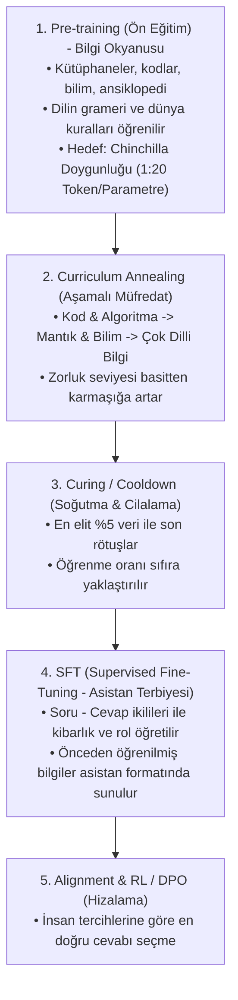

# 📘 Dorina-AI Mühendislik ve Eğitim El Kitabı (AI Lab Blueprint)

Bu doküman, Dorina-AI projesinin 2. Nesil (Sparse MoE + Byte-Level BPE) mimarisine geçerken edinilen tüm endüstriyel tecrübeleri, veri müfredatı dağılımlarını, eğitim hiyerarşisini ve büyük yapay zeka laboratuvarlarının (OpenAI, DeepSeek, Meta) kullandığı gizli teknik kuralları içermektedir.

---

## 🏛️ 1. Temel Eğitim Hiyerarşisi (Bir Dahi Nasıl Yetiştirilir?)

Bir yapay zeka modelini eğitirken yapılan en büyük hata, genel bilgiye doymadan erken "SFT (Sohbet Terbiyesi)" vermektir.

### ⚠️ Erken SFT Tuzağı (Deneyimimiz):
* **Yaşanan Durum:** Modele Türkçe Pre-train (ansiklopedi/makale) vermeden önce doğrudan *"Sen kimsin?" -> "Ben Dorina"* SFT'si verdiğimizde, model kavramların anlamını bilmediği için papağan gibi soruyu tekrarladı (`Python nedir? -> Python nedir?`). Kod sorulduğunda ise kusursuz çalıştı; çünkü kod tarafında 50M+ token'lık güçlü bir Pre-train temeli vardı!
* **Kural:** **Bilgi olmadan üslup olmaz.** Önce dilin hafızası (Pre-train), sonra asistan kimliği (SFT).

---

## 📊 2. Büyük Dahi Pre-train Veri Dağılımı (Curriculum Mixture)

Modelin dengeli, hem kod yazabilen hem de Türkçe mantık yürütebilen bir dahiye dönüşmesi için uyguladığımız **Altın Oran**:

| Oran | Alan | Kaynak | Amacı & Kazanımı |
| :--- | :--- | :--- | :--- |
| **%35** | **Derin Kodlama & Algoritma** | StarCoder, CodeFeedback, The Stack | Fonksiyonlar, algoritmalar, veri yapıları, syntax refleksi. |
| **%35** | **Mantık, Bilim & Felsefe** | FineWeb-Edu (Sample 10BT) | Sebep-sonuç ilişkileri, matematiksel düşünce, problem çözümü. |
| **%20** | **Kapsamlı Türkçe Ansiklopedi & Kültür** | Turkish Wikipedia (`umarigan/turkish_wikipedia`), Makaleler | Türkçe kelime bağlamları, kavram tanımları, fiil çekimleri. |
| **%10** | **Yapılandırılmış Mantık & Dokümantasyon** | JSON, YAML, Markdown, Docstrings | Düşüncelerini düzenli formatta sunabilme yeteneği. |

---

## ⚡ 3. Chinchilla Scaling Law (Doygunluk Kuralı)

* **Kural:** Bir modelin kapasitesini tam kullanabilmesi (compute-optimal) için **parametre başına en az 20 token** görmesi gerekir.
* **Dorina-MoE Parametreleri:**
  - **Toplam Parametre:** `44,452,608` (~44.5M)
  - **Aktif Parametre:** `30,296,832` (~30.3M)
* **Doygunluk Hesabı:**
  $$\text{Doygunluk Hedefi} = 44.5\text{M} \times 20 \approx \mathbf{900\text{ Milyon Token}}$$
* **Pratik Ölçek:**
  - İlk 50-100M token: Model syntax ve temel kavramları söker (Ortaokul seviyesi).
  - 100M - 300M token: Algoritmik problem çözme ve derin Türkçe anlama oturur (Lise seviyesi).
  - 500M+ token: Sıfır hata ile çalışan uzman seviyesi.

---

## 🛡️ 4. Tier-1 AI Lab Otomasyon & Güvenlik Protokolleri

1. **Router Z-Loss (ST-MoE / PaLM Standardı):**
   - MoE router katmanındaki logitlerin float16 sınırlarında patlamasını engeller.
   $$\mathcal{L}_{z} = 10^{-4} \times \text{mean}\left(\log^2\sum e^{\text{logits}}\right)$$
2. **Weight Decay Exclusions:**
   - LayerNorm, Bias ve Embedding katmanlarına asla `weight_decay` uygulanmaz! Uygulanırsa model kelimelerin anlamlarını (embedding) zamanla unutur.
3. **SpikeGuard & Rollback:**
   - Anlık kayıp (loss) son 20 adım ortalamasının 2.5 katına fırlarsa o adım atlanır; `NaN` olursa son sağlıklı checkpoint'e geri sarılır.
4. **EarlyStopping (Doyum Sigortası):**
   - Validation loss arka arkaya 5-6 denetim boyunca gelişmezse modelin veriyi tam sindirdiği anlaşılır ve eğitim güvenle tamamlanır.

---

## 🧭 5. Terimler Sözlüğü (Glossary)

* **MoE (Mixture of Experts):** Modeli tek bir dev blok yapmak yerine birden fazla uzman ağa bölüp, her kelime için sadece en uygun 2 uzmanı (Top-2) çalıştırma tekniği.
* **Router (Yönlendirici):** Gelen kelimeyi hangi uzmanların işleyeceğine karar veren yönlendirici katman.
* **RoPE (Rotary Position Embedding):** Kelimelerin cümle içindeki sırasını vektörleri döndürerek kodlayan modern pozisyon tekniği (Llama ve DeepSeek standardı).
* **SwiGLU:** Klasik ReLU yerine çok daha yüksek öğrenme kapasitesi sunan gelişmiş aktivasyon fonksiyonu.
* **Warm Start:** Eğitime sıfırdan başlamak yerine, önceki aşamada öğrenilen ağırlıkların üzerine yeni bilgileri ekleyerek devam etme yöntemi.
* **Catastrophic Forgetting:** Bir modele yeni bir şey öğretirken eski öğrendiklerini tamamen unutması felaketi.
* **Cross-Lingual Transfer:** Bir dilde (İngilizce) öğrenilen mantık ve muhakeme kurallarının, kavramsal vektör uzayı sayesinde diğer dillere (Türkçe) sıfır eforla aktarılabilmesi.

---

## 📐 6. Talha-Curriculum 10 - 80 - 10 Altın Kuralı (Doygunluk Müfredatı)

Büyük modellerin (Llama 3 / DeepSeek) aşırı doygunluk (over-training) stratejisi 3 ana kampa bölünür:

1. **İlk %10 (Isınma & Dil Örüntüleri - 100M Token):**
   - Basit syntax, kelime/token frekansları, temel kodlama yapıları.
   - Öğrenme oranı sıfırdan maksimuma çıkarılır (Warmup).
2. **Orta %80 (Büyük Gövde / Ham Zeka - 800M Token):**
   - Derin algoritmalar, felsefe, fen, matematik, sebep-sonuç ilişkileri.
   - Öğrenme oranı yüksek ve kararlı tutulur. 4 Uzman organik olarak uzmanlaşır.
3. **Son %10 (Soğutma & Kristalleşme - 100M Token):**
   - En elit mantık verileri, zengin Türkçe ansiklopedi ve kusursuz problem çözümleri.
   - Öğrenme oranı minimuma indirilir (Cool-down / Annealing). Öğrenilen zeka taş gibi mühürlenir.

---

## 🌐 7. Çok Dilli Strateji: "Önce Saf Zeka, Sonra Kavram Köprüsü"

* **Temel Kural:** Modelin kafasını erken aşamada dillerle karıştırmıyoruz.
* **Yol:** Pre-training %100 evrensel mantık, matematik ve kodlama (İngilizce) ile yürütülür.
* **Kavramlar Dilden Bağımsızdır:** Model `Gravity` veya `Binary Search` kavramını evrensel uzayda anladıktan sonra, doyum aşamasında paralel sözlük ve Türkçe kaynaklar verilerek dil bir "etiket" gibi var olan zekanın üzerine oturtulur.

---

## 🤖 8. SLM (Küçük Model) İçin Bilgisayar Kontrolü ve Tool Calling Mimarisi

---

## 🛡️ 9. Veri Hijyeni Protokolü ve Anti-Drift Filtreleri (Altın Mühendislik Kuralı)

Model eğitimlerinde yaşanan en büyük tehlike **Domain Drift (Alan Kayması)** ve **Format Pollution (Biçim Kirlenmesi)** sorunudur.
10-80-10 kuralının Aşama 1 ve Aşama 2 pre-training evrelerinde bu filtreler **tavizsiz uygulanır**:

### A. Anti-Framework & Anti-Boilerplate Filtresi:
* **Yasaklılar:** `from django`, `import django`, `settings.py`, `secret_key`, HTML tagları, kurumsal web konfigürasyon dosyaları.
* **Neden?:** Ham kod verisi olarak çekilen açık kaynak repolardan gelen devasa framework dosyaları modelin saf algoritma (`is_prime`, `binary_search`, `fibonacci`) üretme refleksini köreltir ve modeli "web ayar dosyası yazarı"na çevirir.
* **Kural:** Yalnızca saf algoritma blokları, fonksiyonlar (`def`), sınıflar (`class`), matematik formülleri ve döngüler kabul edilir.

### B. Anti-ChatML Filtresi (Pre-train Evresinde):
* **Yasaklılar:** `<|im_start|>user`, `assistant`, soru-cevap etiketleri.
* **Neden?:** Aşama 2 pre-train sırasında modele yoğun soru-cevap formatı verilirse, model kod tamamlamak yerine gevezelik yapmaya, ödev sorusu metni üretmeye başlar.
* **Kural:** Chat ve asistan kalıpları **yalnızca Aşama 3 (SFT)** evresinde verilir! Pre-train evresinde `extract_pure_code()` ile sadece saf kod gövdesi ayrıştırılarak beslenir.

### C. The Golden Pre-train Blend (Altın Karışım Oranı):
* **%40 Saf Algoritma & Kod:** (Döngüler, arama/sıralama, veri yapıları, OOP)
* **%35 İleri Bilim & Felsefe:** (FineWeb-Edu akademik makaleler)
* **%15 Matematik & Mantık:** (Teoremler, denklemler, algoritmik ispatlar)
* **%10 Dünya Bilgisi & Tanımlar:** (Ansiklopedik kavramlar)

---

## 🎖️ 10. Muharebe Günlüğü: Sahada Alınan Dersler ve Hatalar (Post-Mortem & Lessons Learned)

Bir yapay zeka modelini kitaplardan okuyarak değil, doğrudan GPU üzerinde yaşayarak öğrendiğimiz gerçek saha tecrübeleri:

### 1. Ders: Erken SFT Felaketi (Dorina v0.25 SFT Olayı)
* **Hata:** Model daha pre-train aşamasında kavramları ve dili tam sindirmeden erken dönemde "Sen kimsin? -> Ben Dorina" formatına sokuldu.
* **Sonuç:** Model Türkçe kavramların anlamını bilmediği için papağan gibi kullanıcı promptlarını kopyaladı (`Python nedir? -> Python nedir?`).
* **Kazanılan Kural:** Bilgi olmadan üslup olmaz. Önce devasa pre-train ile genel zeka oturtulur, üslup (SFT) en son verilir.

### 2. Ders: Aşırı Soru-Cevap Kayması (Run 5 İlk Deneme)
* **Hata:** Shard 1'e derin algoritmalar öğreteceğiz diye 60M token `CodeFeedback` (Soru-Cevap) formatında yüklendi.
* **Sonuç:** Model `def is_prime(n):` promptu aldığında fonksiyon yazmak yerine soru metni (`Your task is to write a function...`) yazan bir gevezeye dönüştü. Sınav puanı 51.5'ten 40.5'e düştü.
* **Kazanılan Kural:** Pre-training sırasında soru-cevap formatı KESİNLİKLE YASAKTIR. Sadece saf kod gövdesi ve saf metin verilir.

### 3. Ders: Domain Drift / Kütüphane Zehirlenmesi (Run 5 İkinci Deneme)
* **Hata:** Açık kaynak kodları temiz diye `codeparrot-clean` filtresiz verildi. İçindeki devasa Django/web framework ayarları modelin algoritma hafızasını bastırdı.
* **Sonuç:** Model asal sayı sorulduğunda `from django.db import models` yazmaya başladı. Kod mantığı puanı 19.5'ten 6.5'e geriledi.
* **Kazanılan Kural:** Framework, boilerplate ve konfigürasyon dosyaları elenmeli. Model doğrudan döngüleri, matematiksel fonksiyonları ve saf algoritma yapılarını görmelidir.

### 4. Ders: 100M Güvenli Parçalama Kuralı (Talha Savunma Hattı)
* **Tecrübe:** Veriyi tek parça 800M yerine 100M'lik parçalara bölme kararı projenin can simidi oldu. Eğer 800M'lik tek parça eğitseydik, saatler süren eğitim sonunda tüm model çöp olacaktı. 100M'lik kontrol noktaları sayesinde sapmaları anında tespit edip bir önceki temiz ağırlığa (Run 4) geri dönebildik.
* **Kazanılan Kural:** Asla tek parça devasa eğitim başlatma. Daima 100M parçalarla ilerle ve her parça sonunda 100 puanlık benchmark ile doğrula.

